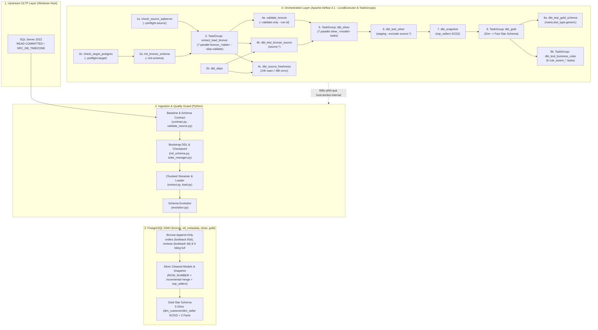

# Olist E-Commerce Enterprise Medallion Data Pipeline

[](https://www.python.org/)
[](https://airflow.apache.org/)
[](https://www.postgresql.org/)
[](https://www.getdbt.com/)
[](https://www.docker.com/)
[](https://www.microsoft.com/sql-server)
[](.github/workflows/ci.yml)

---

## 1. Introduction

- **Project overview**:
  Hệ thống Data Engineering xây dựng theo kiến trúc **Medallion Architecture (`Bronze` -> `Silver` -> `Gold`)**, trích xuất dữ liệu thương mại điện tử Olist từ **Microsoft SQL Server (OLTP)**, nạp trực tiếp vào **PostgreSQL Data Warehouse** theo cơ chế **Bronze Append-Only**, làm sạch/khử trùng lặp tại tầng **Silver**, và mô hình hóa **Kimball Star Schema** tại tầng **Gold** bằng **dbt Core** dưới sự điều phối tự động của **Apache Airflow 3.1**.
- **Project objectives**:
  - Tách biệt hoàn toàn pha **Extract & Load (`E-L`)** bằng Python khỏi pha **Transform (`T`)** bằng dbt SQL.
  - Đảm bảo tính **Idempotency** (chạy lại không sai lệch dữ liệu), hỗ trợ **Crash Recovery** theo từng chunk bằng ACID transaction + checkpoint, và kiểm soát **Schema Contract / Schema Evolution** tự động.
  - Tự động hóa quy trình theo dõi chất lượng dữ liệu đa tầng (`Source` -> `Silver` -> `Gold Schema` -> `Business Rules`) và kiểm thử CI trên **GitHub Actions** kèm dịch vụ `postgres:16`.
- **Business problem**:
  Dữ liệu giao dịch OLTP trên SQL Server phát sinh biến động trạng thái đơn hàng theo thời gian (`created` -> `shipped` -> `delivered`), có thể phát sinh bản ghi trùng lặp, thiếu khóa ngoại hoặc thay đổi cấu trúc cột từ hệ thống nguồn. Nếu ghi đè trực tiếp hoặc làm sạch bằng script rời rạc sẽ dễ mất dấu lịch sử kiểm toán, nghẽn khi chạy lại toàn bộ bảng lớn và khó truy vết nguyên nhân khi báo cáo doanh thu BI sai lệch.

---

## 2. Architecture

### System architecture
Hệ thống phân tách thành 4 lớp vận hành chính:
1. **Upstream OLTP (Windows Host)**: SQL Server (`READ COMMITTED`, cấu hình múi giờ nguồn `SRC_DB_TIMEZONE`).
2. **Orchestration Layer (Docker Compose - Apache Airflow 3.1 `LocalExecutor`)**: Gồm 4 container chạy nền (`airflow_metadb`, `airflow-apiserver`, `airflow-scheduler`, `airflow-dag-processor`) và 1 container khởi tạo (`airflow-init`), kết nối về DB trên máy host qua `host.docker.internal`.
3. **Ingestion Engine (`/opt/etl_venv` / `.venv`)**: Kiểm tra kết nối tách biệt Source/Target, đối chiếu Schema Contract, stream từng chunk qua `psycopg2` `COPY`, ghi checkpoint nguyên tử và đồng bộ cột mới (`ALTER TABLE ADD COLUMN`).
4. **PostgreSQL Data Warehouse & dbt Core**: Chứa các schema `bronze` (dữ liệu thô + `_etl_watermarks`, `_etl_run_history`), `etl_metadata` (`_pipeline_checkpoints`, `_pipeline_chunk_checkpoints`), `silver` (bảng làm sạch + `snp_sellers`), `gold` (Star Schema), và `test_failures` (lưu bản ghi vi phạm dbt test).

### Data flow



---

## 3. Technology Stack

- **Python (`3.12`)**: `SQLAlchemy`, `pyodbc`, `psycopg2`, `pandas`, `PyYAML`, `python-dotenv`, `unittest` cho bộ máy trích xuất/nạp song song, kiểm soát Schema Contract và kiểm thử tự động.
- **PostgreSQL (`16`)**: Data Warehouse đích cho các tầng `bronze`, `silver`, `gold`, schema metadata `etl_metadata`, schema lỗi `test_failures`, và metadata DB của Airflow (`airflow_metadb`).
- **dbt (`dbt-postgres==1.11.0`, `dbt_utils`)**: Thực thi SQL transformation dạng incremental merge tại Silver, `dbt snapshot` (SCD Type 2), Star Schema tại Gold, kiểm tra độ tươi mới nguồn và 4 tầng data test.
- **Airflow (`Apache Airflow 3.1.0`, `LocalExecutor`)**: Điều phối toàn bộ DAG [olist_medallion_elt.py](file:///d:/code/personal_project/etl_ecommerce_data/airflow/dags/olist_medallion_elt.py) theo `TaskGroup`, hỗ trợ retry exponential backoff, giới hạn concurrency (`max_active_tasks=3`) và webhook alert khi task thất bại.
- **Docker (`Docker Compose` + custom [airflow/Dockerfile](file:///d:/code/personal_project/etl_ecommerce_data/airflow/Dockerfile))**: Đóng gói sẵn Airflow 3.1, Microsoft ODBC Driver 18 for SQL Server và virtualenv `/opt/etl_venv` độc lập cho ETL & dbt.

---

## 4. Project Structure

```text
etl_ecommerce_data/
├── .github/workflows/ci.yml          # GitHub Actions CI: Unit + Live Postgres 16 Tests, dbt Build/Test, Docker Build
├── .env.example                      # Template mẫu biến môi trường cho SQL Server, Postgres, Alert & Airflow
├── .gitignore                        # Loại trừ .venv, logs, target, dbt_packages, .env
├── requirements.txt                  # Danh sách thư viện Python cho ETL & test
├── docker-compose.yml                # Khởi chạy 5 service Airflow 3.1 (metadb, init, apiserver, scheduler, dag-processor)
├── main.py                           # Entrypoint CLI (--preflight-source/-target, --init-schema, --table, --skip-validate, --validate-only)
│
├── airflow/
│   ├── Dockerfile                    # Image Airflow 3.1 + ODBC Driver 18 + /opt/etl_venv
│   └── dags/olist_medallion_elt.py   # DAG điều phối chi tiết gồm 4 TaskGroup & 10 standalone tasks
│
├── docs/
│   ├── olap_olist.drawio             # Sơ đồ Star Schema tầng Gold (OLAP)
│   └── oltp_olist.drawio             # Sơ đồ dữ liệu nguồn SQL Server (OLTP)
│
├── sql/
│   ├── source/validate_source.sql    # Truy vấn kiểm đếm dòng & dải ngày baseline nguồn SQL Server
│   └── raw/
│       ├── raw_table.sql             # DDL khởi tạo 7 bảng Bronze, _etl_watermarks & _etl_run_history
│       └── validate_bronze.sql       # Truy vấn kiểm toán số dòng, PK null/duplicate & dải ngày Bronze
│
├── src/
│   ├── config/                       # settings.py (đọc .env, tạo SQLAlchemy URI) & extract_rules.yaml
│   ├── core/                         # connection.py (source/target healthcheck), logger.py (UTC), alert.py (webhook)
│   ├── ingestion/                    # extract.py (dynamic query + chunk generator), load.py (COPY + ACID chunk commit)
│   ├── state/                        # state_manager.py (checkpoints), watermark.py (_etl_watermarks), history.py
│   ├── schema/                       # contract.py (bảo vệ PK), evolution.py (ADD COLUMN tự động), init_schema.py
│   └── validate/                     # validate_source.py & validate_target.py
│
├── tests/                            # 20 bài kiểm thử (Unit + Live PostgreSQL Integration)
│   ├── test_schema_contract.py       # Kiểm tra Schema Contract & ánh xạ kiểu dữ liệu Evolution
│   ├── test_extract_query.py         # Kiểm tra sinh SQL động (Watermark, Resume >=, Timezone)
│   ├── test_state_and_alert.py       # Kiểm tra cấu hình Checkpoint schema & Webhook Alert guard
│   ├── test_airflow_orchestration.py # Kiểm tra AST DAG, TaskGroup, cờ CLI và roundtrip --skip-validate/--validate-only
│   └── test_integration_pipeline.py  # Kiểm tra End-to-End Crash Recovery & Live Postgres ACID/Schema Evolution
│
├── dbt_transform/
│   ├── dbt_project.yml               # Cấu hình schema silver/gold, pre-hook timeout, store_failures -> test_failures
│   ├── packages.yml                  # Khai báo dbt-labs/dbt_utils
│   ├── profiles.yml                  # Kết nối PostgreSQL (threads: 4, connect_timeout: 60)
│   ├── macros/                       # generate_schema_name.sql, unique_combination.sql
│   ├── snapshots/snp_sellers.sql     # SCD Type 2 theo dõi thay đổi vị trí người bán
│   ├── models/staging/               # sources.yml, schema.yml & 7 model stg_* (dedup + incremental merge)
│   ├── models/marts/                 # schema.yml, 5 Dimensions & 2 Facts (fact_orders, fact_sales)
│   └── tests/                        # 6 singular tests kiểm tra business rules tầng Gold
│
└── logs/
    ├── pipeline.log                  # Log Extract & Load Python chuẩn UTC
    ├── dbt.log                       # Log thực thi và kiểm định của dbt
    ├── run_state/                    # JSON snapshot baseline/stat theo từng run_id phục vụ --validate-only
    └── airflow/                      # Log chi tiết các task & DAG processor của Apache Airflow
```

---

## 5. Installation

1. **Yêu cầu tiên quyết**:
   - **Python** 3.12 (hoặc 3.11+)
   - **PostgreSQL** 15/16 và **Microsoft SQL Server** 2017/2019/2022
   - **Microsoft ODBC Driver 18 for SQL Server** (hoặc Driver 17)
   - **Docker Desktop / Docker Compose** (nếu chạy Airflow containerized)
2. **Clone repository và tạo môi trường ảo**:
   ```powershell
   git clone https://github.com/your-username/etl_ecommerce_data.git
   cd etl_ecommerce_data
   python -m venv .venv
   .\.venv\Scripts\Activate.ps1
   ```
   *(Trên Linux/macOS: `python3 -m venv .venv && source .venv/bin/activate`)*
3. **Cài đặt thư viện Python**:
   ```powershell
   pip install --upgrade pip
   pip install -r requirements.txt
   ```
4. **Cài đặt dbt package (`dbt_utils`) nếu chạy dbt trực tiếp trên máy**:
   ```powershell
   cd dbt_transform
   ..\.venv\Scripts\dbt.exe deps
   cd ..
   ```

---

## 6. Configuration

Tạo file `.env` từ template [`.env.example`](file:///d:/code/personal_project/etl_ecommerce_data/.env.example):

```powershell
Copy-Item .env.example .env
```

Điền đầy đủ các nhóm biến trong `.env`:

```ini
# Logging
LOG_LEVEL_CONSOLE=INFO
LOG_LEVEL_FILE=DEBUG

# Nguồn SQL Server (OLTP)
SRC_DB_DRIVER=ODBC Driver 18 for SQL Server
SRC_DB_SERVER=localhost
SRC_DB_PORT=1433
SRC_DB_NAME=E_commerce
SRC_DB_TRUSTED_CONNECTION=no
SRC_DB_TRUST_SERVER_CERTIFICATE=yes
SRC_DB_USER=sa
SRC_DB_PASSWORD=YourStrongPassword

# Đích PostgreSQL Data Warehouse
TGT_DB_HOST=localhost
TGT_DB_PORT=5432
TGT_DB_NAME=olist_dwh
TGT_DB_USER=postgres
TGT_DB_PASSWORD=YourPostgresPassword
TGT_DB_SCHEMA=bronze

# Vận hành & Cảnh báo
ETL_MAX_WORKERS=4
SRC_DB_TIMEZONE=UTC
ALERT_WEBHOOK_URL=
ALERT_ON_SCRIPT_ERROR=true

# Apache Airflow 3.1 (Docker Compose)
AIRFLOW_UID=50000
AIRFLOW_PORT=8080
AIRFLOW_ADMIN_USER=admin
AIRFLOW_ADMIN_PASSWORD=admin
AIRFLOW_DB_USER=airflow
AIRFLOW_DB_PASSWORD=airflow
AIRFLOW_DB_NAME=airflow
AIRFLOW_FERNET_KEY=your_fernet_key
AIRFLOW_JWT_SECRET=your_jwt_secret
```

*(Lưu ý: khi chạy qua [docker-compose.yml](file:///d:/code/personal_project/etl_ecommerce_data/docker-compose.yml#L26-L36), container Airflow tự động ghi đè `SRC_DB_SERVER=host.docker.internal`, `TGT_DB_HOST=host.docker.internal` và `ALERT_ON_SCRIPT_ERROR=false` để tránh gửi trùng cảnh báo khi Airflow retry.)*

Quy tắc trích xuất từng bảng (`strategy`, `chunksize`, `lookback_days`, `primary_keys`, `columns`) được cấu hình tập trung trong [src/config/extract_rules.yaml](file:///d:/code/personal_project/etl_ecommerce_data/src/config/extract_rules.yaml).

---

## 7. Pipeline Execution

### Cách 1: Chạy tự động qua Apache Airflow + Docker Compose (Khuyên dùng)

```powershell
# Khởi tạo & bật cụm Airflow 3.1
docker compose up -d --build
```

Sau khi các container ở trạng thái `Up (healthy)` (`docker compose ps`), truy cập **http://localhost:8080**, chọn DAG **`olist_medallion_elt`** và bấm **Trigger DAG** (có tham số `full_refresh` mặc định `false`, lịch tự động lúc **02:00 sáng** hằng ngày theo giờ `Asia/Ho_Chi_Minh`).

```powershell
# Tắt cụm Airflow (vẫn giữ dữ liệu airflow_metadb_data)
docker compose down
```

### Cách 2: Chạy thủ công / Debug cục bộ trên PowerShell

```powershell
# 1. Kiểm tra kết nối & khởi tạo schema Bronze + bảng metadata
.\.venv\Scripts\python.exe main.py --preflight-source
.\.venv\Scripts\python.exe main.py --preflight-target
.\.venv\Scripts\python.exe main.py --init-schema

# 2. Nạp tầng Bronze (toàn bộ 7 bảng song song, tuần tự, hoặc tách riêng 1 bảng)
.\.venv\Scripts\python.exe main.py
.\.venv\Scripts\python.exe main.py --sequential
.\.venv\Scripts\python.exe main.py --table orders --skip-validate --run-id local_run_1
.\.venv\Scripts\python.exe main.py --validate-only --table orders --run-id local_run_1

# 3. Chạy biến đổi & kiểm định dbt
cd dbt_transform
..\.venv\Scripts\dbt.exe source freshness
..\.venv\Scripts\dbt.exe test --select source:*
..\.venv\Scripts\dbt.exe run --select staging
..\.venv\Scripts\dbt.exe test --select staging --exclude source:*
..\.venv\Scripts\dbt.exe snapshot
..\.venv\Scripts\dbt.exe run --select marts
..\.venv\Scripts\dbt.exe test --select marts,test_type:generic
..\.venv\Scripts\dbt.exe test --select test_type:singular
cd ..
```

---

## 8. Data Transformation

1. **Tầng Bronze (`bronze`, `etl_metadata`)**:
   - Nạp nguyên bản theo chiến lược trong [extract_rules.yaml](file:///d:/code/personal_project/etl_ecommerce_data/src/config/extract_rules.yaml): `lookback_window` cho `orders` (60 ngày) và `order_reviews` (3 ngày); `full` reload cho 5 bảng còn lại (`customers`, `order_items`, `order_payments`, `products`, `sellers`).
   - Bổ sung 2 cột audit (`_extracted_at`, `_batch_id`) và cập nhật checkpoint/watermark ngay trong transaction.
2. **Tầng Silver (`silver`)**:
   - 7 model `stg_*` chạy `materialized='incremental'` với `incremental_strategy='merge'` và `unique_key` + unique index.
   - Khử trùng lặp bằng `ROW_NUMBER() OVER (PARTITION BY pk ORDER BY _extracted_at DESC)`, chuẩn hóa kiểu dữ liệu và chuỗi (`lower(trim(...))`).
   - Snapshot [snp_sellers.sql](file:///d:/code/personal_project/etl_ecommerce_data/dbt_transform/snapshots/snp_sellers.sql) theo dõi lịch sử thay đổi địa điểm người bán theo chiến lược `check` (SCD Type 2).
3. **Tầng Gold (`gold`)**:
   - Xây dựng 5 bảng Dimension (`dim_date`, `dim_location`, `dim_product`, `dim_customer` SCD Type 2, `dim_seller` SCD Type 2 từ `snp_sellers`) và 2 bảng Fact (`fact_orders`, `fact_sales`) với Surrogate Key sinh bởi `dbt_utils.generate_surrogate_key`.
   - Có sẵn bản ghi unknown (`-1`/`-2`/`-3` hoặc UUID `00000000-0000-0000-0000-000000000000`) để bảo toàn toàn vẹn tham chiếu.

---

## 9. Data Quality

Dự án áp dụng khung kiểm thử chất lượng 4 tầng kết hợp kiểm thử Python:

| Tầng kiểm tra | Cơ chế / Selector | Nội dung kiểm định | Vị trí cấu hình |
| :--- | :--- | :--- | :--- |
| **1. Schema & Source / Bronze** | `contract.py`, `validate_target.py`, `source freshness`, `source:*` | Chặn thiếu cột PK từ nguồn; đối soát số dòng/mốc thời gian với baseline; cảnh báo freshness 24h / lỗi 48h; kiểm tra `not_null` / `unique` thô. | [src/schema/contract.py](file:///d:/code/personal_project/etl_ecommerce_data/src/schema/contract.py)<br>[dbt_transform/models/staging/sources.yml](file:///d:/code/personal_project/etl_ecommerce_data/dbt_transform/models/staging/sources.yml) |
| **2. Silver Staging** | `staging --exclude source:*` | `not_null`, `unique`, `unique_combination`, và `accepted_values` cho `order_status`, `payment_type`, `review_score`. | [dbt_transform/models/staging/schema.yml](file:///d:/code/personal_project/etl_ecommerce_data/dbt_transform/models/staging/schema.yml) |
| **3. Gold Schema** | `marts,test_type:generic` | Kiểm tra duy nhất Surrogate Keys và ràng buộc khóa ngoại (`relationships`) giữa Fact và toàn bộ Dimensions. | [dbt_transform/models/marts/schema.yml](file:///d:/code/personal_project/etl_ecommerce_data/dbt_transform/models/marts/schema.yml) |
| **4. Gold Business Rules** | 6 singular tests (`assert_*.sql`) | Đối chiếu doanh thu & số lượng item giữa `fact_orders` và `fact_sales`, kiểm tra thứ tự ngày đơn hàng, giá/phí không âm, điểm review 1–5. | [dbt_transform/tests/](file:///d:/code/personal_project/etl_ecommerce_data/dbt_transform/tests/) |

Bất kỳ bản ghi nào vi phạm test dbt đều được tự động lưu vào schema `test_failures` trên PostgreSQL (cấu hình `+store_failures: true` trong [dbt_transform/dbt_project.yml](file:///d:/code/personal_project/etl_ecommerce_data/dbt_transform/dbt_project.yml#L34-L37)).

Chạy toàn bộ bộ kiểm thử tự động Python (20 test cases gồm Unit Tests, DAG AST, Crash/Resume & Live PostgreSQL Integration):

```powershell
.\.venv\Scripts\python.exe -m unittest discover -s tests -v
```

---

## 10. Monitoring and Logging

- **Airflow Web UI (`http://localhost:8080`)**: Giám sát trực quan trạng thái từng bảng/model qua 4 `TaskGroup` (`extract_load_bronze`, `dbt_silver`, `dbt_gold`, `dbt_test_business_rules`) và 10 task độc lập.
- **Webhook Alerting ([alert.py](file:///d:/code/personal_project/etl_ecommerce_data/src/core/alert.py) & [olist_medallion_elt.py](file:///d:/code/personal_project/etl_ecommerce_data/airflow/dags/olist_medallion_elt.py#L60-L91))**: Gửi thông báo qua Slack/Discord khi task Airflow thất bại sau các lần retry (`on_failure_callback`).
- **Hệ thống Log & Metadata tách tầng**:
  - [logs/pipeline.log](file:///d:/code/personal_project/etl_ecommerce_data/logs/pipeline.log): Log Extract & Load chuẩn UTC (`RotatingFileHandler`).
  - [logs/dbt.log](file:///d:/code/personal_project/etl_ecommerce_data/logs/dbt.log): Log biên dịch SQL và kết quả chạy/test của dbt.
  - `logs/airflow/`: Log chi tiết từng task attempt và `dag_processor` của Airflow.
  - Bảng `etl_metadata._pipeline_checkpoints`, `etl_metadata._pipeline_chunk_checkpoints`, `bronze._etl_watermarks`, và `bronze._etl_run_history` lưu trạng thái chunk, mốc watermark và lịch sử mỗi batch nạp.

---

## 11. Results

- Pipeline vận hành hoàn chỉnh end-to-end từ SQL Server qua PostgreSQL Data Warehouse với đầy đủ 5 schema mục tiêu: `bronze`, `etl_metadata`, `silver`, `gold`, và `test_failures`.
- Bộ kiểm thử Python cục bộ đạt **`20/20` tests passed** (bao gồm kiểm chứng crash recovery `IN_PROGRESS` -> resume `>= watermark`, ACID chunk rollback, và Schema Evolution trực tiếp trên PostgreSQL).
- Workflow [GitHub Actions CI](file:///d:/code/personal_project/etl_ecommerce_data/.github/workflows/ci.yml) tự động kiểm tra 3 job: `python-unit-tests` (kèm service `postgres:16`), `dbt-validation` (bootstrap Bronze + chạy/test đầy đủ Medallion trên `postgres:16`), và `docker-build`.
- Dữ liệu tầng `gold` sẵn sàng cho truy vấn phân tích BI, ví dụ:

```sql
-- Doanh thu theo tháng & điểm hài lòng trung bình
SELECT
    d.year,
    d.month,
    d.month_name,
    COUNT(DISTINCT fo.order_key) AS total_orders,
    SUM(fo.total_order_amount) AS gross_revenue,
    ROUND(AVG(fo.review_score), 2) AS avg_satisfaction_score
FROM gold.fact_orders fo
INNER JOIN gold.dim_date d ON fo.purchase_date_key = d.date_key
WHERE fo.order_status = 'delivered'
GROUP BY d.year, d.month, d.month_name
ORDER BY d.year, d.month;
```

---

## 12. Future Improvements

- **Tách riêng `Extract` và `Load` qua vùng Landing Zone (Parquet / MinIO / S3)**: Lưu chunk trung gian dưới dạng Parquet/Object Storage để bước Load vào PostgreSQL có thể retry độc lập mà không cần truy vấn lại SQL Server.
- **Nối luồng End-to-End theo từng bảng (`Per-table Lineage`)**: Cho phép các bảng nhỏ (`sellers`, `products`) đi thẳng từ `bronze_<table>` -> `silver_stg_<table>` mà không cần chờ các bảng lớn (`order_items`).
- **Tích hợp BI Dashboard & dbt Docs Hosting**: Kết nối trực tiếp schema `gold` với Metabase / Apache Superset / Power BI và xuất bản `dbt docs generate` tự động.
- **Mở rộng CI/CD**: Bổ sung SQL Server container vào CI để test E2E cả luồng extract ODBC thực tế trên GitHub Actions.

---

## 13. Author

- **Tác giả**: Toan Pham (`phamminhtoan318@gmail.com`)
- **Bộ dữ liệu**: [Brazilian E-Commerce Public Dataset by Olist](https://www.kaggle.com/datasets/olistbr/brazilian-ecommerce)
- **Giấy phép**: MIT License
